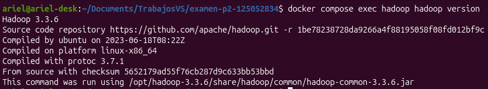
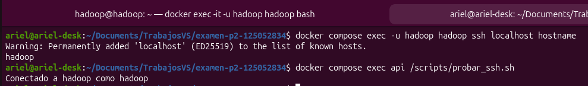
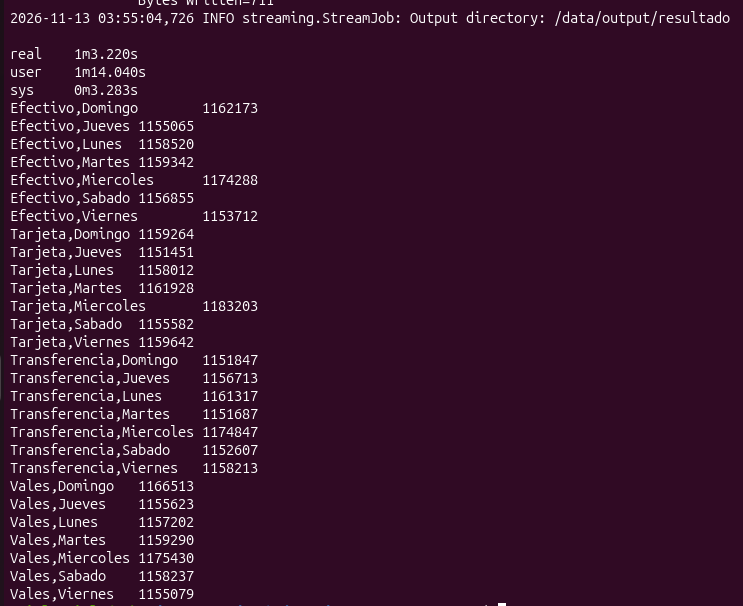
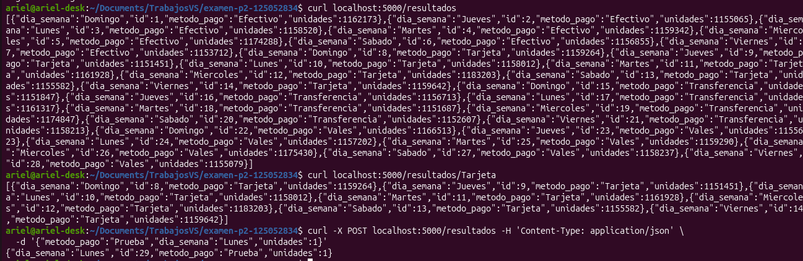

# Examen Segundo Parcial: Pipeline de datos contenerizado

| Campo | Valor |
|---|---|
| Alumno | Ariel López Miranda |
| Matrícula | 125052834 |
| Materia | Manejo Masivo de Datos (Big Data) |
| Universidad | UPQ |

## Pregunta asignada

La matrícula termina en **4**, por lo que la pregunta de negocio es: **unidades vendidas por método de pago y día de la semana**. La clave de salida es `MetodoPago,Dia` y el valor es la suma de la columna `cantidad`. Con 4 métodos de pago y 7 días, el resultado final tiene 28 registros.

## Estructura del repositorio

```
examen-p2-125052834/
├── README.md
├── .gitignore
├── .env.example
├── docker-compose.yml
├── hadoop/
│   ├── Dockerfile
│   └── entrypoint.sh
├── mapreduce/
│   ├── mapper.py
│   ├── reducer.py
│   └── secuencial.py
├── api/
│   ├── Dockerfile
│   ├── requirements.txt
│   └── app.py
├── scripts/
│   ├── cargar_resultados.py
│   ├── correr_job.sh
│   └── probar_ssh.sh
└── evidencias/
```

## Cómo reproducirlo

1. Generar el dataset con la matrícula como semilla y colocarlo en `data/`. El CSV no se sube al repositorio porque `.gitignore` lo excluye.

```bash
python3 generar_dataset.py 125052834
mv ventas_125052834.csv data/
```

2. Crear el archivo de variables de entorno a partir del ejemplo y ajustar la contraseña.

```bash
cp .env.example .env
```

3. Construir y levantar los tres servicios (`hadoop`, `db`, `api`) en la red `pipeline`.

```bash
docker compose up --build -d
docker compose ps
```

## Evidencias

### A1. Hadoop instalado en Debian

```bash
docker compose exec hadoop hadoop version
```



### B. SSH sin contraseña

El contenedor `hadoop` genera un par de llaves ed25519 sin passphrase al arrancar y las guarda en el volumen `ssh_keys`, que el contenedor `api` monta en solo lectura. Así no hay credenciales en el Dockerfile.

```bash
docker compose exec -u hadoop hadoop ssh localhost hostname
docker compose exec api /scripts/probar_ssh.sh
```




### C1. Job de MapReduce con Hadoop Streaming

```bash
docker compose exec hadoop /scripts/correr_job.sh
```

El mapper ignora el encabezado y descarta las líneas mal formadas (con un número de campos distinto de 8, fecha inválida o cantidad no numérica) sin detener el job. El reducer suma los valores de cada clave, aprovechando que Hadoop se los entrega ordenados.



### C2. Versión secuencial y verificación

```bash
time python3 mapreduce/secuencial.py data/ventas_125052834.csv > output/secuencial.txt
diff output/secuencial.txt output/resultado/part-00000 && echo COINCIDEN
```


### D. Base de datos y API

```bash
docker compose exec api python /scripts/cargar_resultados.py
curl localhost:5000/resultados
curl localhost:5000/resultados/Tarjeta
curl -X POST localhost:5000/resultados -H 'Content-Type: application/json' \
  -d '{"metodo_pago":"Prueba","dia_semana":"Lunes","unidades":1}'
curl -X DELETE localhost:5000/resultados/Prueba/Lunes
```

| Método | Ruta | Función |
|---|---|---|
| GET | `/resultados` | Todos los registros |
| GET | `/resultados/<metodo>` | Registros de un método de pago |
| POST | `/resultados` | Crear o actualizar un registro |
| PUT | `/resultados/<metodo>/<dia>` | Actualizar las unidades |
| DELETE | `/resultados/<metodo>/<dia>` | Eliminar un registro |



### Persistencia

```bash
docker compose down
docker compose up -d
curl localhost:5000/resultados
```

Los datos siguen disponibles porque Postgres guarda su información en el volumen nombrado `pgdata`, que `docker compose down` no elimina.


## Comparativa de rendimiento

Ambos métodos produjeron exactamente el mismo resultado (`diff` sin diferencias), pero el tiempo cambió bastante: el script secuencial tardó aproximadamente **15 segundos** y el job de Hadoop Streaming cerca de **1 minuto**, es decir, varias veces más.

| Método | Tiempo aproximado | Resultado |
|---|---|---|
| Script secuencial (Python) | ~15 s | Coincide |
| Hadoop Streaming (standalone) | ~1 min | Coincide |

En este escenario el script secuencial fue más rápido porque el archivo de 400 MB cabe sin problema en una sola máquina y el trabajo de cómputo es pequeño. Hadoop, en cambio, paga costos fijos que aquí no se compensan: arrancar la JVM, planear el job, lanzar los procesos de Python del mapper y del reducer, y escribir y ordenar los resultados intermedios (shuffle y sort). Además, en modo standalone todo corre en un solo nodo, así que no hay paralelismo real entre máquinas. MapReduce conviene cuando los datos superan lo que una máquina puede manejar (cientos de GB o TB), cuando hay un clúster con varios nodos que reparten el trabajo y cuando HDFS permite procesar cada bloque donde está almacenado, además de tolerar fallos.

## Posibles cambios en la defensa

### Cambiar el puerto de la API

Se modifica `API_PORT` en `.env` y se vuelve a levantar el servicio. Dentro del contenedor la API sigue en el 5000; solo cambia el puerto publicado en el equipo.

```bash
sed -i 's/^API_PORT=.*/API_PORT=8080/' .env
docker compose up -d
curl localhost:8080/resultados
```

### Cambiar de suma a promedio

El promedio no se puede calcular sumando promedios parciales, así que el mapper envía la cantidad junto con un 1 y el reducer acumula ambas cosas.

En `mapper.py`, la línea final de impresión pasa a:

```python
    print(f"{metodo},{dia}\t{cantidad},1")
```

En `reducer.py`, el cuerpo se ajusta para acumular suma y conteo:

```python
import sys

clave_actual = None
suma = 0
conteo = 0

for linea in sys.stdin:
    try:
        clave, valor = linea.rstrip("\n").split("\t")
        cantidad, uno = valor.split(",")
        cantidad = int(cantidad)
        uno = int(uno)
    except ValueError:
        continue
    if clave == clave_actual:
        suma += cantidad
        conteo += uno
    else:
        if clave_actual is not None:
            print(f"{clave_actual}\t{suma / conteo:.4f}")
        clave_actual = clave
        suma = cantidad
        conteo = uno

if clave_actual is not None:
    print(f"{clave_actual}\t{suma / conteo:.4f}")
```

Como la salida ya no son enteros, `cargar_resultados.py` y la columna `unidades` de la tabla tendrían que cambiar a `NUMERIC` si se quisiera cargar ese resultado a la base.

### Filtrar por mes

En `mapper.py`, justo después de obtener `fecha`, se descartan los registros de otros meses. Con marzo como ejemplo:

```python
        fecha = campos[1][:10]
        if fecha[5:7] != "03":
            continue
```

Se vuelve a correr `/scripts/correr_job.sh`, que borra el directorio de salida anterior antes de ejecutar.

### Borrar el volumen de la base y recargar

```bash
docker compose down -v
docker compose up -d
docker compose exec api python /scripts/cargar_resultados.py
curl localhost:5000/resultados
```

Con `down -v` se pierden los datos de Postgres, pero `output/resultado/part-00000` sigue en el equipo, por lo que basta con volver a cargarlo.

### Explicar el Dockerfile y el compose

- **`FROM debian:bookworm-slim`:** imagen base ligera de Debian.
- **`openjdk-17-jdk-headless`:** Java sin interfaz gráfica, requerido por Hadoop.
- **`ln -s ... /usr/lib/jvm/java`:** ruta fija para `JAVA_HOME`, sin depender de la arquitectura del equipo.
- **`ENV HADOOP_HOME` y `PATH`:** permiten ejecutar `hadoop` desde cualquier lugar.
- **`ENTRYPOINT` y `CMD`:** el entrypoint prepara las llaves SSH y después ejecuta `sshd -D`, que mantiene vivo el contenedor.
- **`depends_on` con `service_healthy`:** la API espera a que Postgres acepte conexiones, no solo a que el contenedor haya arrancado.
- **Volumen `:ro` en `/data/input`:** el contenedor solo puede leer el dataset.
- **Red `pipeline`:** permite que los servicios se encuentren por nombre (`db`, `hadoop`).

## Respuestas de teoría

Las respuestas a la Parte E se entregan por separado.